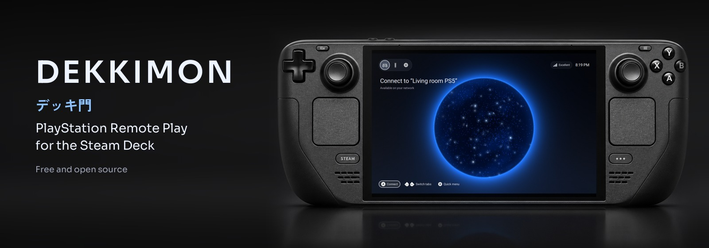
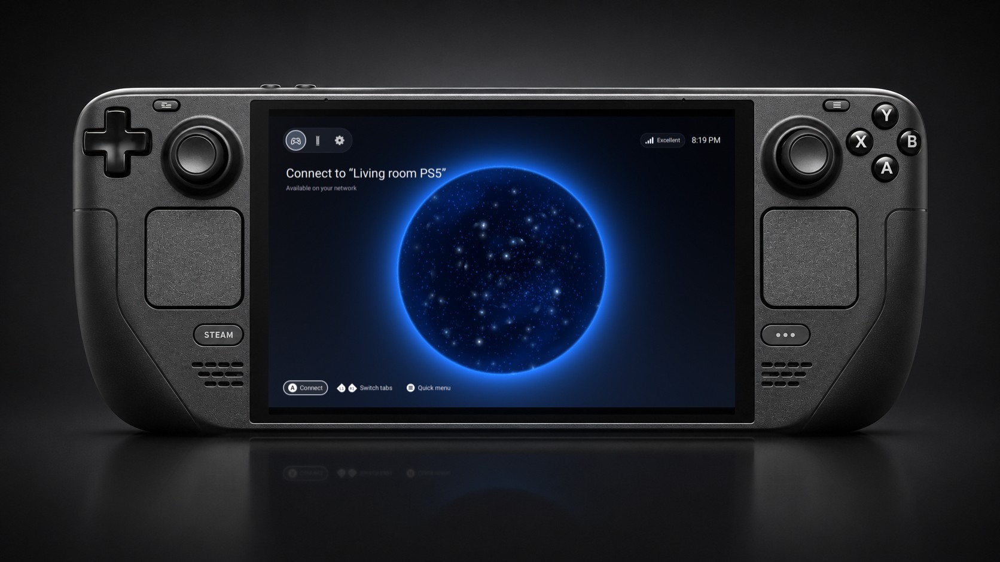
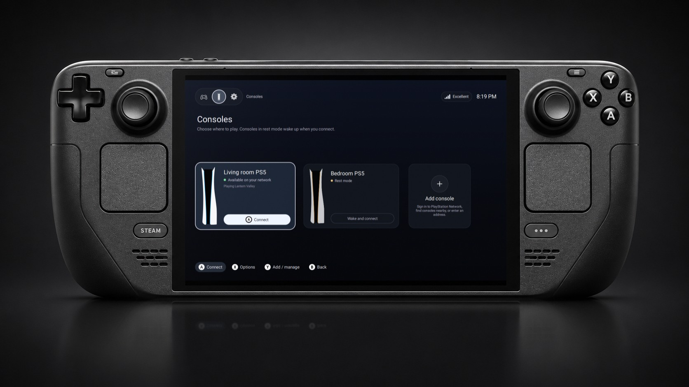
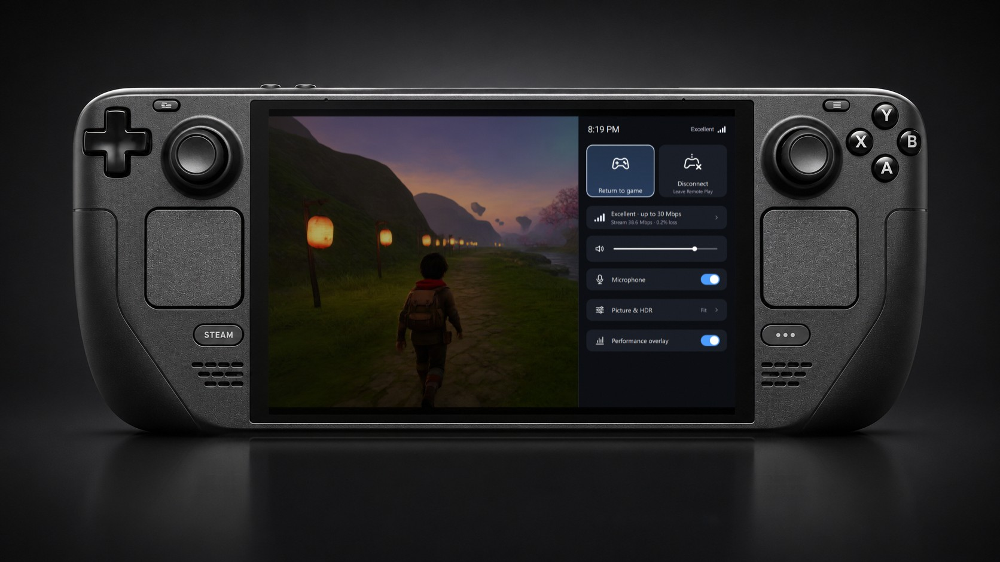
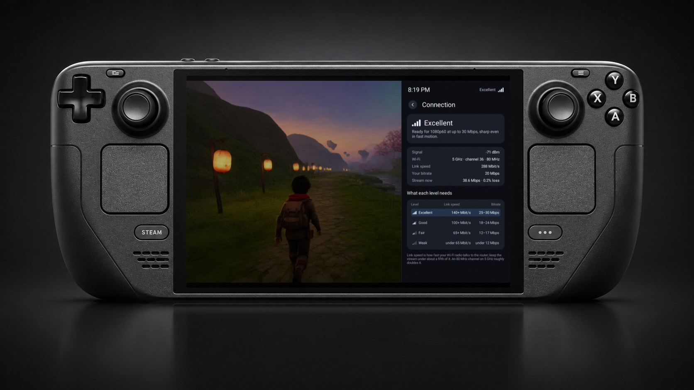
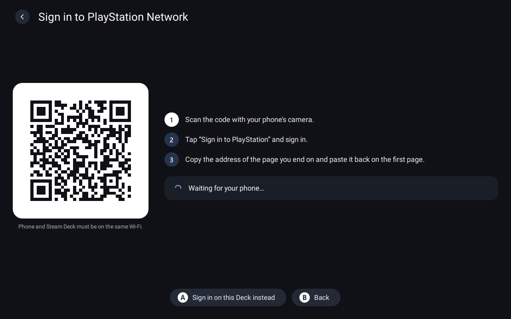
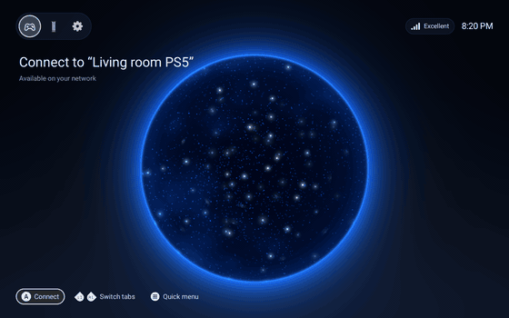
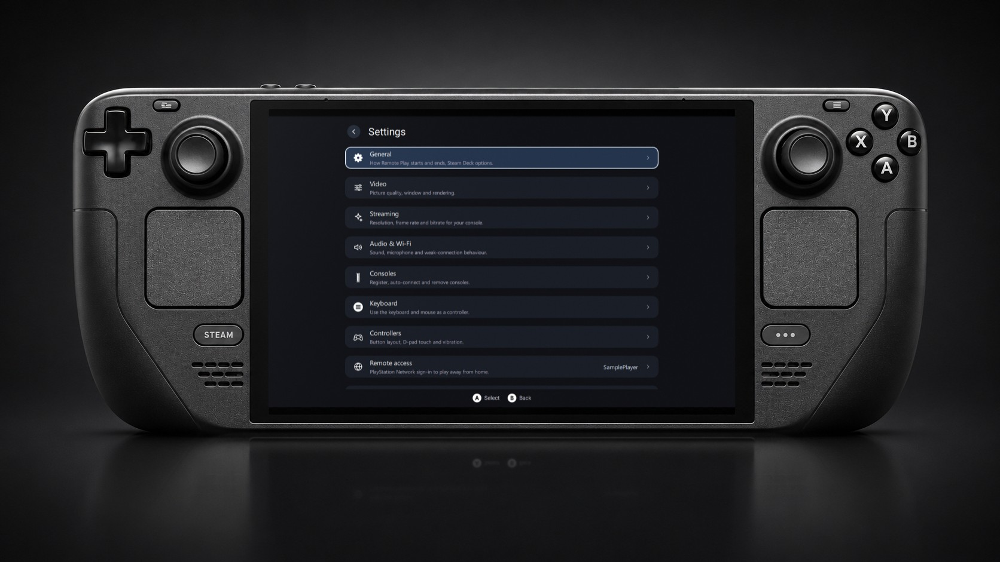
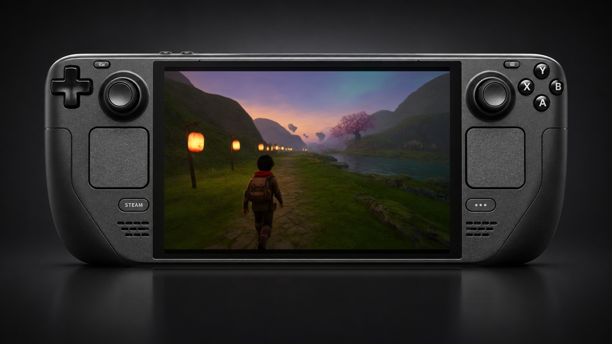

<p align="center">
  
</p>

<p align="center">
  <a href="https://github.com/GabrieleLozupone/dekkimon/releases/latest"></a>
  <a href="https://github.com/GabrieleLozupone/dekkimon/actions/workflows/dekkimon.yml"></a>
  
  <a href="COPYING"></a>
</p>

# Dekkimon <sub>デッキ門</sub>

**PlayStation Remote Play for the Steam Deck**, with a console-style interface built for the
Deck's screen and controls. *Dekkimon* means "Deck Gate" in Japanese: a gate from your Deck to
your PlayStation.

<p align="center">
  
</p>

## Install

On your Steam Deck, in **Desktop Mode**:

1. Download [**Install.Dekkimon.desktop**](https://github.com/GabrieleLozupone/dekkimon/releases/latest/download/Install.Dekkimon.desktop).
2. Double-click it in your Downloads folder, and choose **Continue** if you're asked.
3. Return to Gaming Mode. Dekkimon is in **Library › Non-Steam**, with its artwork and a
   ready-made controller layout.

No browser on the Deck? Paste this into Konsole instead:

```sh
curl -fsSL https://github.com/GabrieleLozupone/dekkimon/releases/latest/download/dekkimon-install.sh | bash
```

To update, run the installer again. Your consoles and settings are kept.
See the [install guide](docs/install.md) for details and how to uninstall.

## Features

<table>
  <tr>
    <td width="50%"></td>
    <td width="50%"></td>
  </tr>
  <tr>
    <td><b>Made for the Steam Deck.</b> Large, controller-first menus at 1280×800. Wake a console
      in rest mode, or add one, from the consoles screen.</td>
    <td><b>A quick menu while you play.</b> Return to the game, disconnect, adjust volume and the
      microphone, or check the connection, without leaving the stream.</td>
  </tr>
  <tr>
    <td></td>
    <td></td>
  </tr>
  <tr>
    <td><b>Smooth streaming over Wi-Fi.</b> A built-in Wi-Fi signal indicator suggests a
      bitrate for your connection. Video freezes after packet loss are fixed, and network buffers
      are larger.</td>
    <td><b>Sign in to PSN with your phone.</b> Scan the QR code on the Deck and sign in on your
      phone. You don't need to type anything on the Deck.</td>
  </tr>
</table>

- **Automatic HDR:** HDR is used when your screen supports it (Steam Deck OLED or an HDR TV).
  Otherwise Dekkimon falls back to SDR, so colors don't look washed out.
- **The PS button on L4**, the Dekkimon menu on R4, and a left trackpad click for the
  touchpad. The installer sets this layout up for you.
- **PS5 and PS4**, at home or away from home over the internet.

<p align="center">
  <br>
  <sub>Connecting to a console</sub>
</p>

## Guides

| Guide | What's in it |
| --- | --- |
| [Install, update and uninstall](docs/install.md) | Desktop Mode installer, Gaming Mode, what goes where |
| [First connection](docs/first-connection.md) | Console settings, pairing, PSN sign-in with your phone |
| [Controls](docs/controls.md) | L4/R4, touchpad, the PS button, mic button as PS |
| [Settings explained](docs/settings.md) | Every setting, and the ones worth changing |
| [Smooth streaming over Wi-Fi](docs/network-optimization.md) | Router settings, bitrate, 60 Hz, HDR, troubleshooting |

## Screenshots

<table>
  <tr>
    <td width="50%"></td>
    <td width="50%"></td>
  </tr>
  <tr>
    <td align="center"><sub>Settings</sub></td>
    <td align="center"><sub>Streaming (the game picture is an illustration)</sub></td>
  </tr>
</table>

## For developers

- [Building and testing](docs/building.md): the SteamOS build container, tests and GPU previews.
- [Taking changes from chiaki-ng](docs/upstream.md): the merge script and how to keep merges small.

## Credits and license

Dekkimon is based on [chiaki-ng](https://github.com/chiaki-ng/chiaki-ng) by Street Pea, a fork
of [Chiaki](https://git.sr.ht/~thestr4ng3r/chiaki) by Florian Markl. Thanks to everyone who
worked on them. The PlayStation Remote Play protocol code is theirs.

Dekkimon is free software under the [GNU Affero General Public License version 3](COPYING)
(with the OpenSSL exception in [LICENSES/](LICENSES)), without any warranty.

Dekkimon is not affiliated with, endorsed by or certified by Sony Interactive Entertainment or
Valve. PlayStation, PS5, PS4 and DualSense are trademarks of Sony Interactive Entertainment.
Steam and Steam Deck are trademarks of Valve Corporation.
