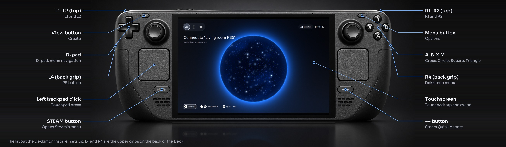
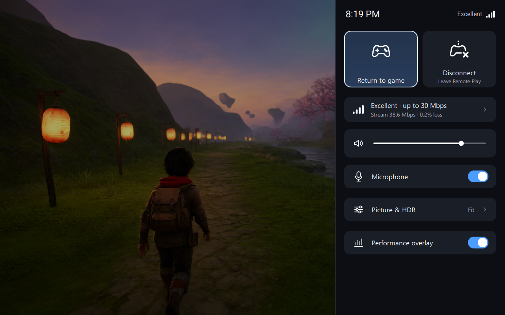

# Controls

The installer sets up a Steam Input layout for Dekkimon. Every Steam Deck control works as on a
DualSense, and the back grips handle what the Deck doesn't have: the PS button and a menu
button.

## While you play

| Steam Deck | PlayStation |
| --- | --- |
| A, B, X, Y | Cross, Circle, Square, Triangle |
| D-pad, sticks, L3, R3 | The same |
| L1, R1, L2, R2 | The same |
| View button (⧉, top left) | Create |
| Menu button (☰, top right) | Options |
| **L4** (upper left back grip) | **PS button** |
| **R4** (upper right back grip) | **Dekkimon stream menu** |
| Left trackpad click | Touchpad press |
| Touchscreen: tap and swipe | Touchpad touch and swipe |
| Gyro | Motion controls |
| Microphone | Voice chat (on or off in the stream menu) |

The STEAM and ••• buttons still open Steam's own menus. They're never sent to the console.

**The stream menu** (R4) lets you return to the game, disconnect, set the volume and
microphone, and check the connection:

You can also open it by holding **L1 + R1 + L3 + R3** together. That's useful on a controller
without back grips. Change the combination in **Settings › General › Stream menu**.

**D-pad as touchpad.** Some games use touchpad swipes. Hold **L1 + R1 + D-pad up** to switch the
D-pad to touchpad swipes, and do it again to switch back. Change it in **Settings ›
Controllers › D-pad as touchpad**.

## In Dekkimon's menus

| Button | What it does |
| --- | --- |
| D-pad or left stick | Move |
| A | Select or connect |
| B | Back |
| L1, R1 | Switch tabs (home, consoles, settings) |
| R4 or Menu (☰) | Quick menu |
| X / Y on the consoles screen | Console options / Add or manage consoles |

The hints at the bottom of each screen show the buttons that work there.

## A DualSense or other controller

You can connect a DualSense to the Deck (Bluetooth or USB) and play with it, including the
touchpad and vibration.

**The PS button opens the Steam menu instead of the console's.** Steam keeps the PS button of
external controllers for itself. Use the **mic button** as the PS button instead:

1. In Dekkimon, go to **Settings › Controllers › Change controller mapping**.
2. Choose **PS**, then **Extra button**, and press the **mic button** on the DualSense.
3. Choose **Save mapping**.

The PS button on the Deck itself (L4) keeps working as before.

## Change the layout

The layout is an ordinary Steam Input layout. To change it, start Dekkimon, press the **STEAM**
button, and choose **Controller settings**. L4 sends the **Escape** key (PS button), R4 sends
**F12** (stream menu) and the left trackpad click sends **T** (touchpad press). Dekkimon turns
those keys into the PlayStation buttons.

To go back to the recommended layout, run the installer with `--reset-controls` (see
[Install](install.md#installer-options)).

## Troubleshooting

**L4, R4 or the trackpad click do nothing.**

- Check that the layout is active: STEAM button › Controller settings while Dekkimon is
  running. It should show the Dekkimon layout, with L4 = Escape and R4 = F12.
- Steam stores layouts by the game's **name**. If you renamed the Dekkimon shortcut, Steam
  starts the new name with a default layout. Rename it back to "Dekkimon", or set the layout up
  again for the new name.
- Check that **Settings › Keyboard › Keyboard as controller** is on in Dekkimon. The back grips
  send keyboard keys.
- Run the installer with `--reset-controls`, then restart Steam.

**Touching the screen does nothing in a game.** Check that **Settings › Keyboard › Mouse as
touchpad** is on.

**The PS button opens the Steam menu.** On the Deck, use L4. On a DualSense, map the mic
button as above.

## Keyboard shortcuts (Desktop Mode)

| Keys | What they do |
| --- | --- |
| F11 | Fullscreen on and off |
| F12, or Ctrl + O | Stream menu or quick menu |
| Ctrl + M | Microphone on and off |
| Ctrl + S | Stretch the picture to the window |
| Ctrl + Z | Zoom the picture to fill the window |
| Ctrl + Q | Quit |
