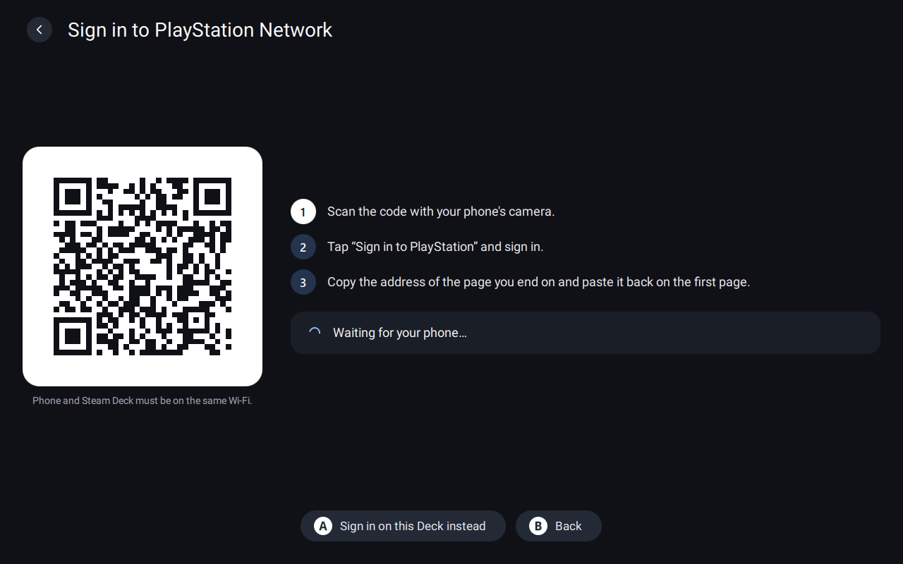
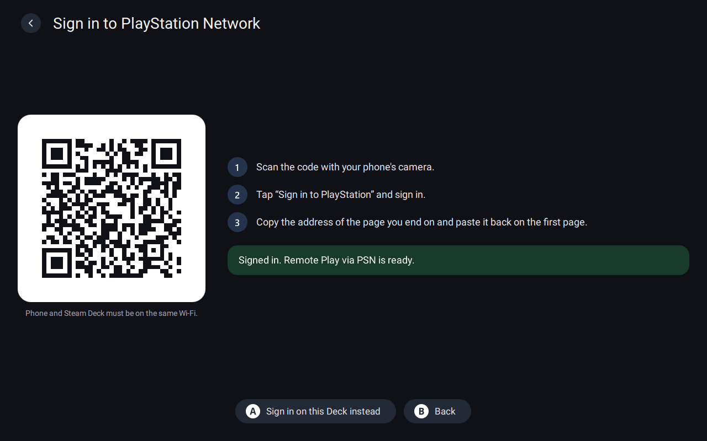
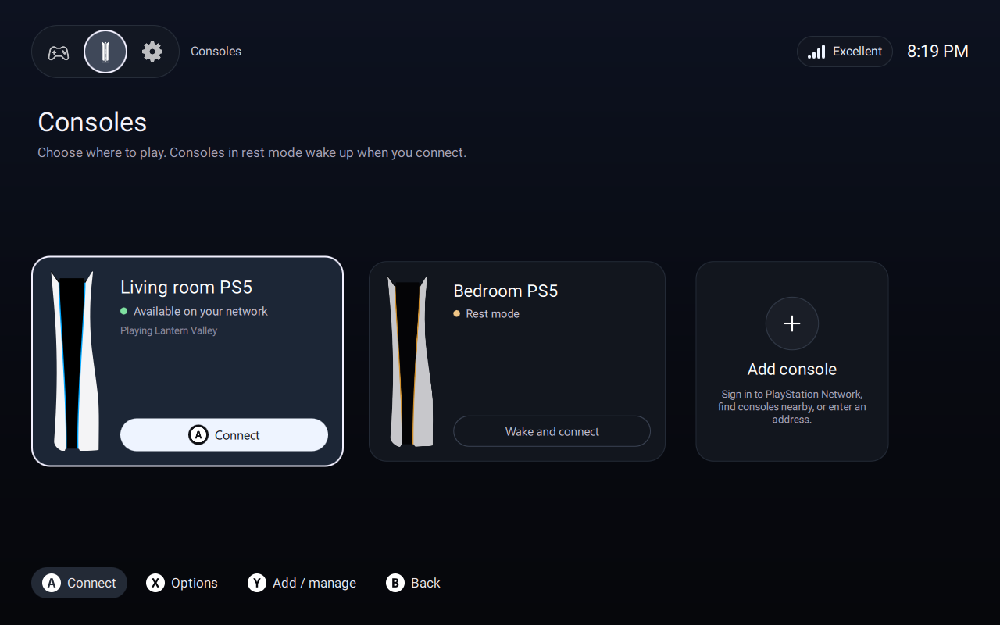
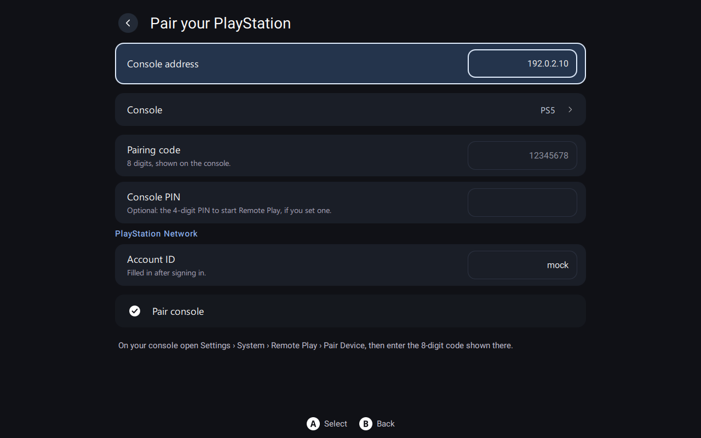
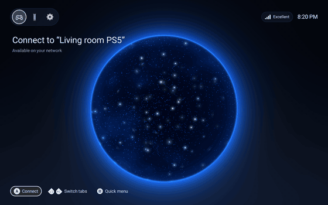
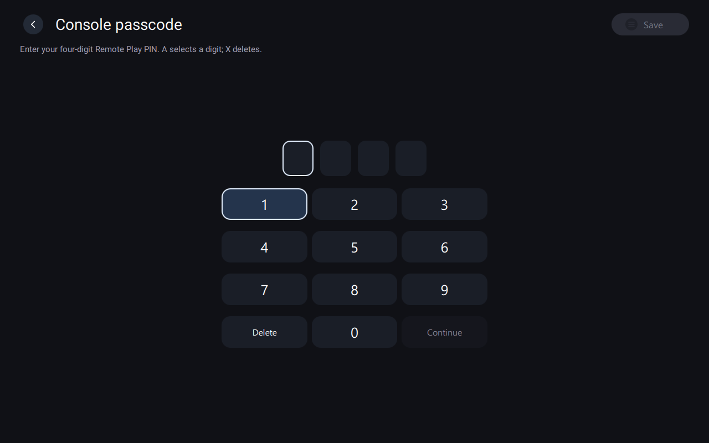

# First connection

This guide gets you from a fresh install to playing: prepare the console, sign in to
PlayStation Network, pair the console once, and connect.

## 1. Prepare your console

Do this once, on the console with a controller.

**PS5**

1. **Settings › System › Remote Play › Enable Remote Play:** on.
2. To start the console from rest mode with Dekkimon, go to **Settings › System ›
   Power Saving › Features Available in Rest Mode**, and turn on **Stay Connected to the
   Internet** and **Enable Turning On PS5 from Network**.

**PS4**

1. **Settings › Remote Play Connection Settings › Enable Remote Play:** on.
2. To start it from rest mode, go to **Settings › Power Save Settings › Set Features Available
   in Rest Mode**, and turn on **Stay Connected to the Internet** and **Enable Turning On PS4
   from Network**.

## 2. Sign in to PlayStation Network with your phone

Signing in gives Dekkimon your account ID, which pairing needs. It also lets you play away from
home without port forwarding. Dekkimon offers it at the first start. Later, it's in
**Settings › Remote access › Sign in to PlayStation Network**.

1. Make sure your phone is on **the same Wi-Fi** as the Deck.
2. Scan the QR code with your phone's camera and open the link.
3. On the phone, tap **Sign in to PlayStation** and sign in with your PlayStation account.
4. At the end, copy the address of the page you're on, go back to the first page, and paste it
   there.

The Deck shows that you're signed in. The code works once and expires after 10 minutes. If it
expires, choose **New code**.

Dekkimon never sees your password: you sign in on Sony's website on your phone, and only the
sign-in token reaches the Deck. To sign out, go to **Settings › Remote access › Sign out**.

No phone at hand? Choose **Sign in on this Deck instead**. Typing is easier in Desktop Mode
with the on-screen keyboard (STEAM + X).

## 3. Find your console

Open the **Consoles** tab (press R1 on the home screen). Consoles on your network appear on
their own. A console in rest mode shows **Wake and connect**.

If your console doesn't appear, choose **Add console** (or press Y for **Add / manage**), then
**Add console manually**, and type the console's IP address. Check that **Discover nearby
consoles** is on there. The console shows it under **Settings › Network › Connection
Status**.

## 4. Pair the console (first time only)

The first time you connect, Dekkimon asks you to pair:

1. On the console, go to **Settings › System › Remote Play › Pair Device** (PS4: **Settings ›
   Remote Play Connection Settings › Add Device**). The console shows an 8-digit code.
2. Enter the code under **Pairing code** in Dekkimon. The account ID is already filled in from
   your PSN sign-in.
3. If you set a Remote Play passcode on the console, enter it under **Console PIN**.
4. Choose **Pair console**.

The code expires after a few minutes. If pairing doesn't finish, get a new code on the console
and try again.

## 5. Connect

On the home screen, press **A** to connect to the console shown. Dekkimon wakes it from rest
mode if needed.

If the console asks for a passcode, enter the 4 digits with the D-pad and A:

During the game, press **R4** for the stream menu. From there you can return to the game,
disconnect, change the volume and microphone, and check the connection. See
[Controls](controls.md).

## Playing away from home

When you're signed in to PSN, Dekkimon can connect over the internet without port forwarding.
Away from home it uses the **Away from home (via PSN)** settings, which default to 720p
because mobile and hotel networks are usually slower (see [Settings](settings.md)).

If connections away from home fail on a strict network (mobile hotspots, some ISPs), turn on
**Settings › Remote access › Force STUN port guessing**.

## Troubleshooting

| Problem | What to try |
| --- | --- |
| The console isn't listed | Check that the console and the Deck are on the same network. Turn the console on once, or add it by address. |
| "Wake and connect" does nothing | Turn on the two rest mode options in step 1. |
| Pairing fails | Get a new code on the console: it's only valid for a few minutes. Check that the console type (PS5, or the PS4 software version) is right. |
| The phone can't open the sign-in page | The phone must be on the same Wi-Fi as the Deck, not on mobile data. |
| The picture stutters or freezes | See [Smooth streaming over Wi-Fi](network-optimization.md). |
