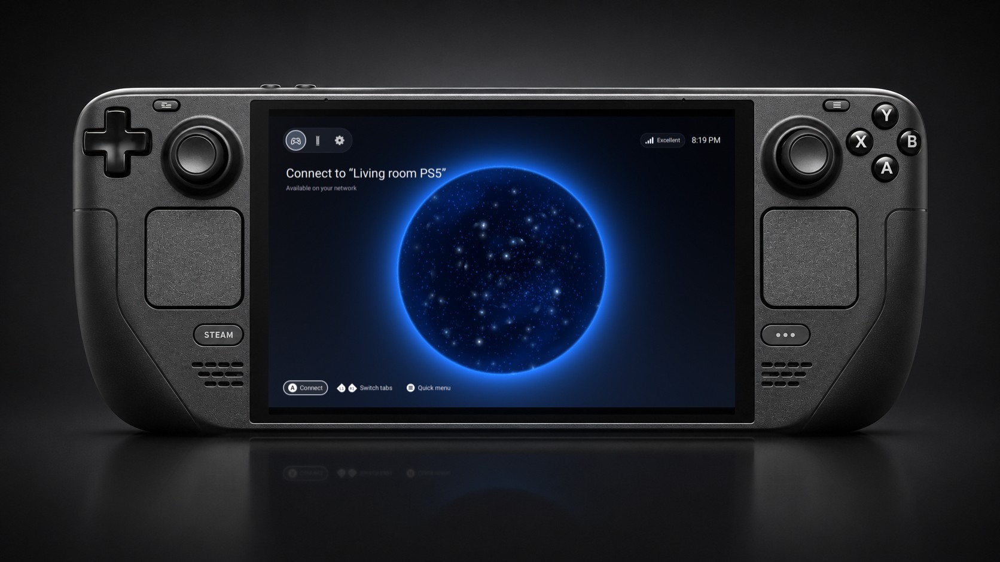
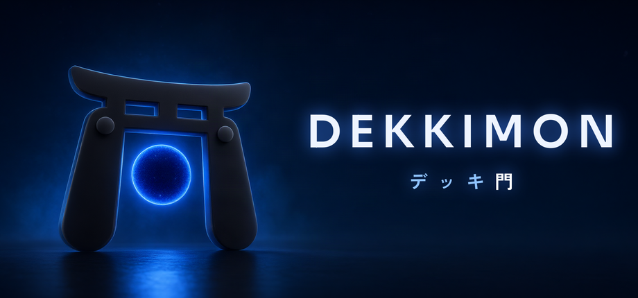
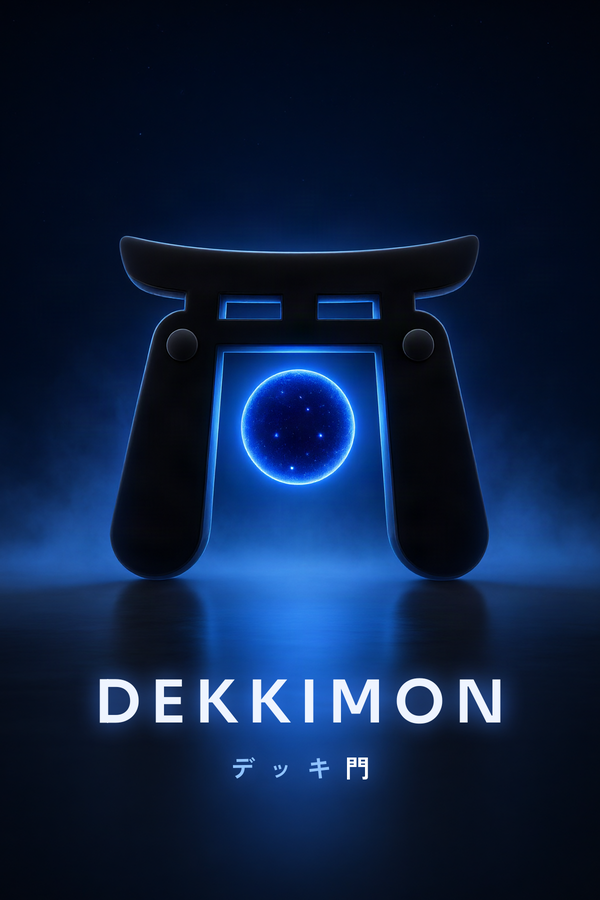
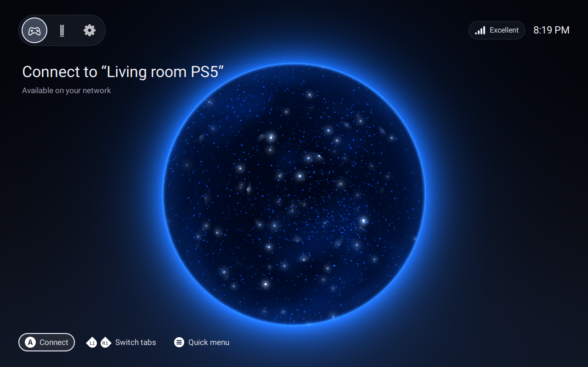

# Install, update and uninstall

Dekkimon installs from the Steam Deck's **Desktop Mode** in about two minutes. After that you
use it from **Gaming Mode**, like any game in your library.

<p align="center"></p>

## What you need

- A Steam Deck (LCD or OLED) with SteamOS 3.9 or newer: Settings › System › About.
- A PlayStation 5 or PlayStation 4 with Remote Play turned on. The
  [first connection guide](first-connection.md) shows how.
- Your Steam Deck signed in to Steam at least once.

## Install

### 1. Switch to Desktop Mode

Press the **STEAM** button, then go to **Power › Switch to Desktop**.

### 2. Run the installer

**With a browser** (Firefox, or any browser from the Discover store):

1. Download [**Install.Dekkimon.desktop**](https://github.com/GabrieleLozupone/dekkimon/releases/latest/download/Install.Dekkimon.desktop).
2. Open your **Downloads** folder and double-click **Install.Dekkimon.desktop**.
3. If KDE warns that the file comes from the internet, choose **Continue** (or **Execute**).

**Without a browser:** open **Konsole** (application menu › System › Konsole) and paste:

```sh
curl -fsSL https://github.com/GabrieleLozupone/dekkimon/releases/latest/download/dekkimon-install.sh | bash
```

A terminal window shows the progress:

```text
==> Downloading Dekkimon (latest release)
==> Installing Dekkimon 0.1.0 in /home/deck/Applications/dekkimon
==> Steam has to be closed while Dekkimon is added to your library (it rewrites the list on exit).
Close Steam now? It will be started again when the installer is done. [Y/n]
```

Press **Enter**. Steam closes, Dekkimon is added to your library, and Steam starts again.

### 3. Go back to Gaming Mode

Double-click **Return to Gaming Mode** on the desktop. You'll find Dekkimon in
**Library › Non-Steam**, with its artwork:

<p align="center">
</p>

Next: [connect to your console](first-connection.md).

<p align="center"></p>

## Manual installation

Download the [Steam Deck release archive](https://github.com/GabrieleLozupone/dekkimon/releases/latest/download/dekkimon-steamdeck.tar.gz),
[installer script](https://github.com/GabrieleLozupone/dekkimon/releases/latest/download/dekkimon-install.sh),
and [SHA256SUMS](https://github.com/GabrieleLozupone/dekkimon/releases/latest/download/SHA256SUMS) from the same release.
Put all three files in **Downloads**.

In Desktop Mode, open Konsole to verify the two downloads:

```sh
cd ~/Downloads
sha256sum --check SHA256SUMS
```

Once both checks report **OK**, install from the local archive:

```sh
bash dekkimon-install.sh --tarball dekkimon-steamdeck.tar.gz
```

For an app-only install, add `--no-steam`. You can add the launcher yourself later by
opening **Games › Add a Non-Steam Game to My Library** in Steam and browsing to
`~/Applications/dekkimon/dekkimon.sh`.

## What the installer does

| What | Where |
| --- | --- |
| The app, its launcher, and two libraries SteamOS doesn't include | `~/Applications/dekkimon/` |
| Your settings, consoles and PSN sign-in | `~/Applications/dekkimon/config/` |
| Logs of recent launches | `~/Applications/dekkimon/logs/` |
| A non-Steam game "Dekkimon", with artwork | Your Steam library |
| The recommended controller layout (see [Controls](controls.md)) | Steam Input, for the "Dekkimon" shortcut |
| An entry in the Desktop Mode application menu | `~/.local/share/applications/dekkimon.desktop` |

It never asks for your password or uses `sudo`, and it changes nothing outside your home
folder. The download is checked against the release's SHA-256 checksums.

## Update

Run the installer again, in the same way. It replaces the app and keeps your settings, consoles,
PSN sign-in and any changes you made to the controller layout or artwork.

## Uninstall

In Desktop Mode, open Konsole and run:

```sh
bash ~/Applications/dekkimon/dekkimon-install.sh --uninstall
```

This removes the app, the Steam shortcut, its artwork and controller layout, and the menu entry.
Your settings stay in `~/Applications/dekkimon/config` in case you reinstall. To remove
everything, add `--purge`.

## Installer options

| Option | What it does |
| --- | --- |
| `--version 0.1.0` | Install a specific release instead of the latest one |
| `--tarball FILE` | Install from a downloaded `dekkimon-steamdeck.tar.gz` |
| `--reset-controls` | Put the recommended controller layout back |
| `--reset-artwork` | Put the Dekkimon artwork back |
| `--no-steam` | Don't touch Steam (no shortcut, artwork or layout) |
| `--yes` | Don't ask before closing Steam |

Use options with the downloaded script, for example
`bash dekkimon-install.sh --reset-controls`.

## Troubleshooting

**Dekkimon isn't in my library.** Restart Steam (or the Deck) once. If it's still missing,
run the installer again and look for an error in the terminal.

**"Steam did not close within a minute."** Close Steam from the tray icon (Steam › Exit) and
run the installer again.

**"No Steam account found."** Start Steam and sign in once, then run the installer again.

**Dekkimon doesn't start after a SteamOS update.** A SteamOS update can change system
libraries that Dekkimon uses. Run the installer to get the latest release. If that doesn't
help, [open an issue](https://github.com/GabrieleLozupone/dekkimon/issues) and attach the
newest file in `~/Applications/dekkimon/logs/`.

**The buttons on the back don't do anything.** See [Controls › Troubleshooting](controls.md#troubleshooting).
