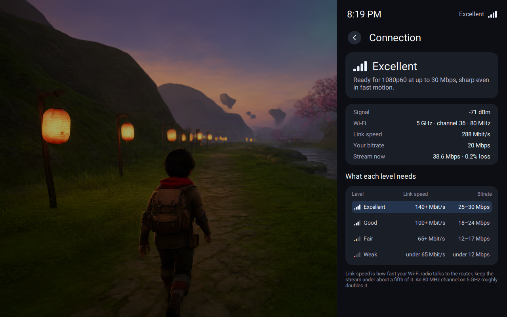

# Smooth streaming over Wi-Fi

Most stutter, freezes and blurry motion when you stream from a PlayStation to a Steam Deck come
from the Wi-Fi link, not from the app. This guide lists what to check, in order of impact. Each
step says why it matters and how to undo it.

The numbers come from sessions on a Steam Deck OLED (SteamOS 3.9) streaming 1080p60 HDR from a
PS5 over 5 GHz Wi-Fi, measured with Dekkimon's [benchmark tools](../scripts/dev/bench/README.md).

<p align="center"></p>

**Start here:** open the **Connection** page (stream menu › connection card, or the quick menu
on the home screen). It shows your Wi-Fi band, channel and width, the signal strength, the link
speed, and the bitrate your link can carry. It also says if the Deck is scanning for other
networks, which causes stutter (step 3).

## Quick checklist

| Step | Where | Fixes |
| --- | --- | --- |
| 1. 5 GHz, fixed channel 36–48, 80 MHz wide | Router | Narrow link, uneven frame delivery at higher bitrates |
| 2. Band steering off | Router | Short disconnects when the signal is weak |
| 3. Stop background Wi-Fi scans | Steam Deck | A stutter every ~35 seconds |
| 4. Refresh rate 60 Hz | Steam Deck | Judder in fast camera moves (the OLED runs at 90 Hz) |
| 5. A bitrate that fits your link | Dekkimon | Stutter at high bitrate, blur at low bitrate |
| 6. "Request a key frame after errors" off | Dekkimon | Half-second freezes after a lost packet |
| 7. Motion blur and film grain off | Game | Soft image while moving fast |
| 8. HDR set up correctly | Steam / console | Wrong brightness or washed-out colors |

## 1. Router: 5 GHz on channel 36–48 at 80 MHz

**Why.** The Deck uses whatever channel width the router chooses. On a 40 MHz channel the Deck
received at 69–103 Mbit/s. On 80 MHz, with the same Deck and router, it got 288 Mbit/s. A
stream at 20–25 Mbps fills a narrow link enough that frames arrive late and in clumps. That
looks like stutter even when no data is lost.

**Why the channel matters, not just the width setting.** Channels 52–144 are radar (DFS)
channels. Routers often stay at 40 MHz there, or drop to it after a radar check, even when
"20/40/80" is selected. Channels 36, 40, 44 and 48 aren't radar channels, and together they form
one 80 MHz block, so the router has no reason to narrow it. The one you pick only sets the
"primary" part of the block. Use 36, unless a neighbour's network is on it.

**What to set** (names vary by router):

1. Open the router's settings page (often http://192.168.1.1 or http://192.168.0.1; the
   password is usually on the router's label).
2. In the 5 GHz Wi-Fi settings:
   - **Channel:** 36 (or 40, 44, 48), not Automatic.
   - **Automatic channel selection or Wi-Fi optimisation:** off, so the router doesn't move
     back.
   - **Bandwidth:** 20/40/80. If the router still uses 40 MHz, try 20/40/80/160 once: on some
     routers that unlocks the wider modes. If stutter comes back with 160 selected, go back to
     20/40/80, because 160 MHz needs radar channels again.
   - **Wi-Fi standard:** ax (Wi-Fi 6) or be (Wi-Fi 7). An "a/n" mode is limited to 40 MHz.
3. Save, wait for the Wi-Fi to come back, then turn the Deck's Wi-Fi off and on. The width is
   agreed when the Deck connects, so the Deck keeps the old width until it reconnects.

**Check it** on Dekkimon's Connection page: it should show **5 GHz · channel 36 · 80 MHz**.
Or in Desktop Mode, in Konsole:

```bash
iw dev wlan0 link | grep -E "signal|bitrate"
iw dev wlan0 info | grep channel
```

You want `width: 80 MHz`, and an rx bitrate that mentions `80MHz`.

**Signal strength** (the `signal:` line): better than -70 dBm is good. Between -70 and -80 dBm
works with a moderate bitrate. Worse than -80 dBm struggles at any setting. A wider channel
spreads the router's power, so check the signal from where you actually play.

## 2. Router: band steering off

Band steering moves devices between 2.4 GHz and 5 GHz on its own. When the Deck's 5 GHz signal
gets weak, the router may push it to 2.4 GHz, sometimes by disconnecting it briefly. During a
stream, that's a freeze. Turning band steering off keeps the Deck on 5 GHz.

Trade-off: your other devices stay on whichever band they joined, instead of being moved
automatically. If a device far from the router misbehaves afterwards, turn it back on.

## 3. Steam Deck: stop background Wi-Fi scans

**Symptom.** Every ~35 seconds, 3–5 seconds of stutter or freezing, often worse when the
signal is weaker.

**Cause.** When the signal is weaker than -70 dBm, SteamOS (NetworkManager) scans for other
access points every 30 seconds, to be able to roam. A scan takes about 5 seconds. During it,
the Wi-Fi radio keeps leaving your channel to listen on others, so video arrives in ~180 ms
gaps and some packets are lost. Above -70 dBm it scans only about once a day, which is why the
problem comes and goes.

**Fix.** Lock the Deck's Wi-Fi connection to your router's access point. A locked connection has
nothing to roam to, so NetworkManager stops scanning. In Desktop Mode, open Konsole. The
`sudo` command asks for your Deck password:

```bash
nmcli -t -f NAME,UUID,DEVICE connection show --active    # note the UUID on the wlan0 line
BSSID=$(iw dev wlan0 link | awk '/^Connected to/{print toupper($3)}'); echo "$BSSID"
sudo nmcli connection modify <UUID> 802-11-wireless.bssid "$BSSID"
sudo nmcli connection up <UUID>
```

If `echo` prints nothing, the Deck isn't connected: stop there. (No Deck password yet? Set one
with `passwd`.)

**Check that it worked.** `timeout 75 iw event -t` should print no `scan started` lines. Before
the fix, there were two in 75 seconds.

**Trade-off.** The Deck only uses that one access point. If you add a mesh node or an extender,
or replace the router, the Deck won't roam to or join the new one until you undo this. Changing
the router's channel doesn't affect the lock. Opening the Wi-Fi list in Steam's settings still
scans, so avoid that in the middle of a stream.

**Undo:**

```bash
sudo nmcli connection modify <UUID> 802-11-wireless.bssid ""
sudo nmcli connection up <UUID>
```

## 4. Steam Deck: refresh rate 60 Hz

The Steam Deck OLED's screen runs at 90 Hz. A 60 fps stream doesn't divide evenly into 90 Hz, so
frames alternate between being shown for one refresh and for two. That judder is most visible
in fast pans. While Dekkimon is running, press **•••** › **Performance**, turn on per-game
settings, and set **Refresh Rate** to **60 Hz**. It costs nothing and doesn't affect the
network.

## 5. Dekkimon: a bitrate that fits your link

The bitrate setting (**Settings › Streaming › Bitrate**) is a maximum. The console picks its
actual target below it, and lowers it when packets are lost. It doesn't react to frames arriving
late, though, so a bitrate too high for your link causes stutter without the console noticing.

| Your link (see the Connection page) | Suggested bitrate (1080p60) |
| --- | --- |
| 40 MHz channel, or signal worse than -75 dBm | 18 Mbps |
| 80 MHz channel, signal -70 to -75 dBm | 20 Mbps |
| 80 MHz channel, signal better than -70 dBm | 25 Mbps, then try higher |

Measured: at 25 Mbps on a 40 MHz link the stream had ~125 ms delivery gaps with no packet loss.
At 18 Mbps the same link was clean. A higher bitrate gives a sharper image in fast motion only
if the link has room for it.

Keep **1080p, 60 fps and H.265**. 1080p is scaled down to the Deck's screen, which is sharper
than 720p scaled up. Changing the resolution resets the bitrate to automatic, so set the bitrate
again afterwards.

## 6. Dekkimon: "Request a key frame after errors" off

**Settings › Audio & Wi-Fi › Advanced › Request a key frame after errors** is off by default.
Keep it off on Wi-Fi. When a frame can't be repaired after packet loss, this option makes the
app wait for a fresh key frame before it shows anything: a freeze of 0.4–1.6 seconds. With it
off, the app keeps going and the console repairs the picture within a moment. You may see a
brief glitch instead, which is less disruptive than a freeze.

Dekkimon also recovers by itself from a rare decoder state where the picture would stay frozen
after a loss. It notices that frames arrive but none are shown, and asks the console for a new
key frame. The picture comes back within about 2 seconds.

## 7. Game: motion blur and film grain off

Antialiasing, motion blur and resolution scaling happen inside the game, on the console. The
Deck receives finished video. In fast games (swinging, driving), turn off **motion blur**,
**film grain** and **depth of field** in the game's own settings. Motion blur is the main reason
fast motion looks soft. Film grain is random noise that the video encoder wastes bitrate on, so
turning it off leaves more bitrate for real detail.

## 8. HDR

Dekkimon chooses HDR or SDR automatically, depending on the screen (see
[Settings › HDR](settings.md#hdr)):

- **On the Steam Deck OLED** (or an HDR TV), turn on **Steam › Settings › Display › Enable
  HDR**, and choose **H.265 HDR** in **Settings › Streaming › Video codec**.
- **On an LCD Deck, or a TV without HDR,** Dekkimon asks the console for SDR, so colors stay
  correct. If colors still look washed out, check that HDR is off in Steam's display settings
  for that screen.
- Run the console's **Adjust HDR** while streaming to the Deck, so it matches the Deck's screen
  rather than your TV.

## Troubleshooting

| What you see | Most likely cause | Fix |
| --- | --- | --- |
| Stutter every ~35 s, lasting a few seconds | Background Wi-Fi scans | Step 3 |
| Steady micro-stutter at higher bitrate, no artifacts | Link too narrow for the bitrate | Steps 1, 5 |
| Half-second freezes after a glitch | "Request a key frame after errors" is on | Step 6 |
| Picture frozen for a second or two, then back | The console paused its video, or a lost frame; Dekkimon recovers by itself | Steps 1, 3 if it happens often |
| Short drop-outs when far from the router | Band steering, or a weak signal | Steps 2, 1 |
| Judder in camera pans, otherwise smooth | 90 Hz screen with a 60 fps stream | Step 4 |
| Soft, smeared image while moving fast | Motion blur in the game, or the bitrate is too low | Steps 7, 5 |
| Image soft only after losses | The console lowered its bitrate after packet loss | Steps 1, 3 |
| Washed-out or too-dark colors | HDR setup | Step 8 |
| PS button (DualSense) opens the Steam menu | Steam keeps the PS button of external controllers | Use L4 on the Deck, or map the mic button to PS: [Controls](controls.md#a-dualsense-or-other-controller) |
| L4 / R4 stopped working after renaming the shortcut | Steam stores layouts by the game's name | [Controls › Troubleshooting](controls.md#troubleshooting) |
