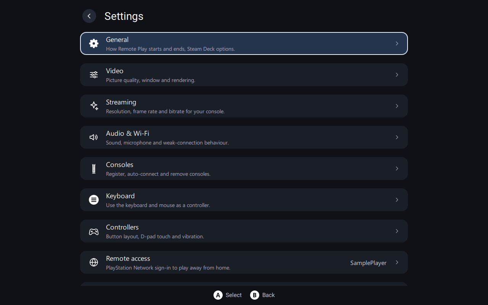
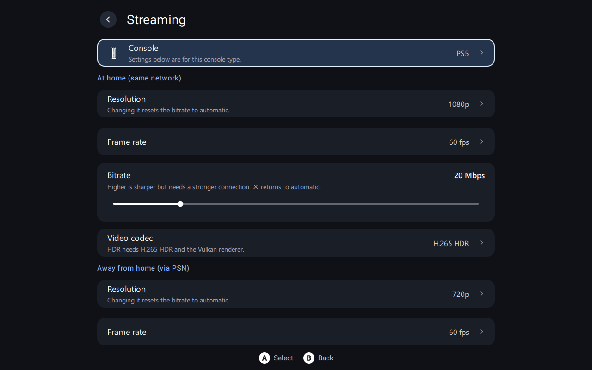
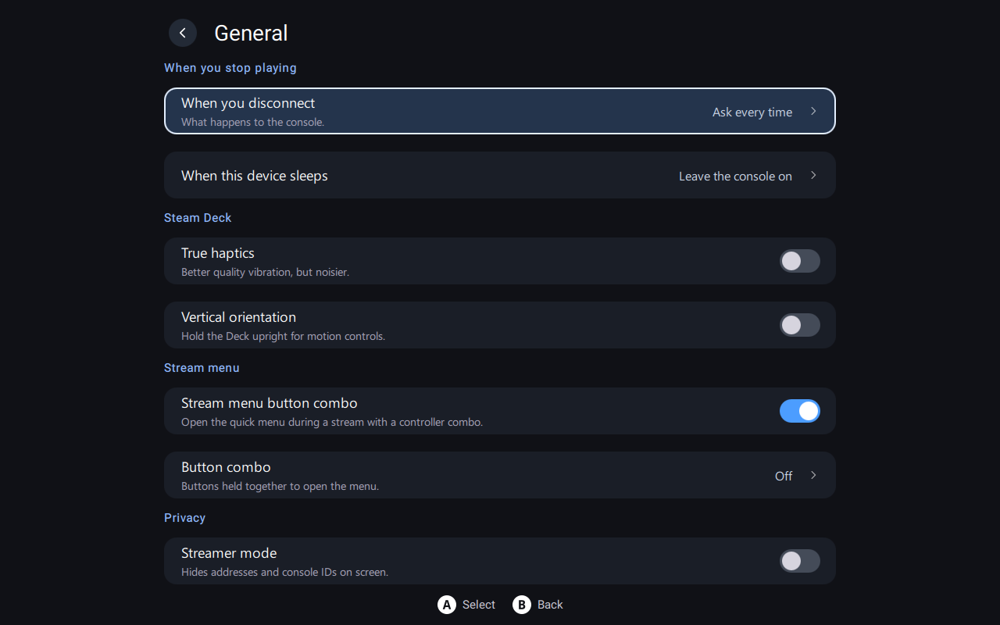
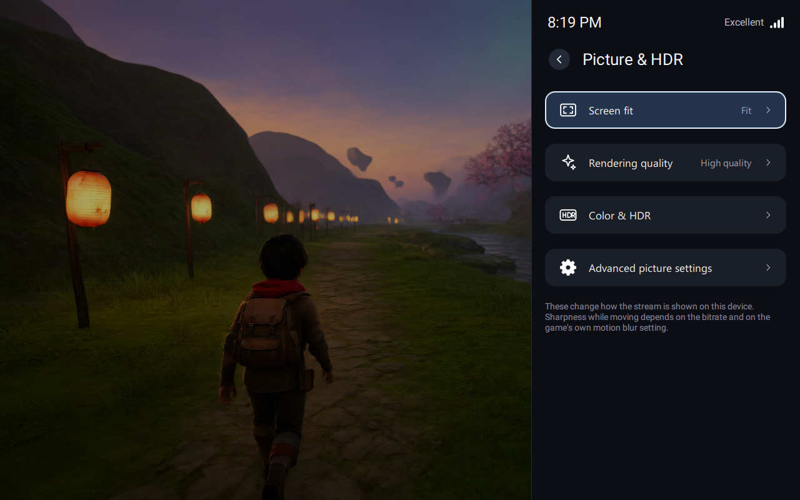

# Settings explained

Open the settings with the gear tab on the home screen (press R1 twice), or from the quick menu.
Each page shows what a setting does and which value is the default. This guide explains the
settings worth knowing, and when to change them.

**Recommended on a Steam Deck:** keep the defaults, sign in to PSN, and set the bitrate to fit
your Wi-Fi (see [Streaming](#streaming)). Everything else is optional.

## Streaming

Resolution, frame rate, bitrate and codec, separately for **PS5 and PS4**, and for **at home**
and **away from home (via PSN)**. Choose the console type at the top of the page.

| Setting | Default | Notes |
| --- | --- | --- |
| Resolution | 1080p at home, 720p away | 1080p is scaled down to the Deck's screen and looks sharper than 720p. Changing it resets the bitrate to automatic. |
| Frame rate | 60 fps | 30 fps halves the data, for weak connections. |
| Bitrate | Automatic (15 Mbps at 1080p) | The highest bitrate the console may use. Higher is sharper in fast motion, if your Wi-Fi can carry it. See the [bitrate table](network-optimization.md#5-dekkimon-a-bitrate-that-fits-your-link). |
| Video codec (PS5) | H.265 | Choose **H.265 HDR** for HDR (see [HDR](#hdr)). H.264 only for very old decoders. |

The **Connection** page in the quick menu shows your Wi-Fi signal and the bitrate it can carry.

## General

- **When you disconnect:** leave the console on, put it in rest mode, or ask every time
  (default).
- **When this device sleeps:** what happens to the console when the Deck goes to sleep during a
  stream.
- **True haptics:** better DualSense-style vibration on the Deck, but noisier.
- **Vertical orientation:** for games where you hold the Deck upright with motion controls.
- **Stream menu button combo:** opens the stream menu with L1 + R1 + L3 + R3, for controllers
  without back grips.
- **Streamer mode:** hides console addresses and IDs on screen, for recording or streaming.

## Video

How the picture is drawn on the Deck. This doesn't change the stream itself.

- **Rendering quality:** Fast, Default, High quality (recommended on the Steam Deck OLED), and
  two spatial-upscaling levels that use more GPU power and battery.
- **Color & HDR:** brightness and tone mapping for HDR (see [HDR](#hdr)).
- **Window size:** only matters in Desktop Mode. Gaming Mode is always fullscreen.
- **Decoding & rendering** (advanced): hardware decoder, frame delivery and renderer. Leave
  these on their defaults: Automatic, Direct mapping, Vulkan. Vulkan is needed for HDR.

## HDR

Dekkimon picks HDR automatically:

- It streams HDR only when the codec is **H.265 HDR**, the renderer is **Vulkan**, and the
  screen accepts HDR. That's the Steam Deck OLED, or an HDR TV, with **Steam › Settings ›
  Display › Enable HDR** turned on.
- If the screen can't show HDR, Dekkimon asks the console for SDR, so colors don't look washed
  out. You can leave H.265 HDR selected all the time.

**Color & HDR** (Settings › Video, or **Picture & HDR** in the stream menu):

- **Peak brightness:** Automatic uses what the display reports. The Steam Deck OLED reaches
  about 1000 nits in HDR.
- **Contrast:** Automatic, or Infinite for true black on OLED.
- **Tone mapping:** Default or High quality. Custom is for experts.

Run the console's own **Adjust HDR** while streaming to the Deck, so its brightness matches the
Deck's screen rather than your TV.

## Audio & Wi-Fi

- **Volume** and **Output device:** the stream's own volume and speaker.
- **Microphone:** start with the microphone on or off, the input device, and noise suppression
  with echo cancellation.
- **Performance overlay:** bitrate and packet loss in a corner during play.
- **Weak Wi-Fi warning:** warns when this share of packets is lost (default 3%).
- **Audio buffer** (advanced): larger is smoother on weak Wi-Fi, but adds delay. Default
  50 ms.
- **Request a key frame after errors** (advanced): **keep it off** on Wi-Fi. When it's on,
  each lost frame freezes the picture for 0.4–1.6 s, until a new key frame arrives. When it's
  off, you see a short glitch instead.

## Consoles

Register a console, choose one to connect automatically when Dekkimon starts (**Auto-connect**),
delete one, or unhide a hidden one.

## Keyboard

- **Keyboard as controller:** must stay **on** on the Steam Deck: the back grips and the
  trackpad click send keyboard keys (see [Controls](controls.md)).
- **Mouse as touchpad:** the touchscreen (and a mouse) act as the DualSense touchpad.
- **Edit key mapping:** which key presses each PlayStation button.

## Controllers

- **Rumble strength** and **Haptics intensity:** vibration for the Deck and other controllers.
- **Change controller mapping:** remap buttons on a connected controller. For example, make
  a DualSense's mic button the PS button (see [Controls](controls.md#a-dualsense-or-other-controller)).
- **D-pad as touchpad:** switch the D-pad to touchpad swipes with L1 + R1 + D-pad up.

## Remote access

Sign in to PlayStation Network with your phone (see [First connection](first-connection.md)), or
sign out. **Force STUN port guessing** can help when connecting away from home fails on a strict
network (mobile hotspots, some ISPs).

## Profiles & data

- **Profiles:** separate sets of settings, for example one for the Deck screen and one for a TV.
- **Export settings** and **Import settings:** save to a file and restore later.
- **Logs:** **Sanitize logs** (on by default) removes personal data from logs. **Verbose
  logging** adds detail when you report a bug. **Open log folder** shows where the logs are.
- **About Dekkimon:** version, credits and license.
